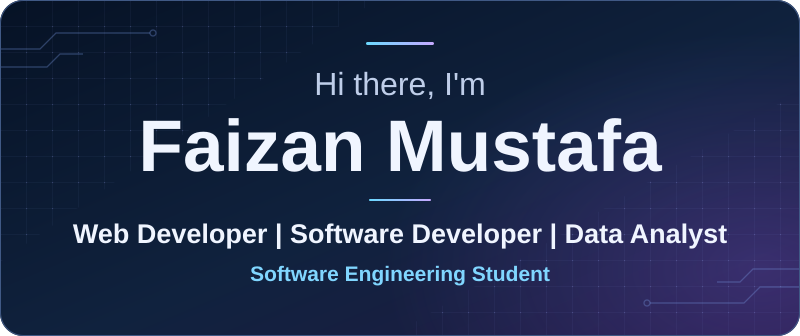
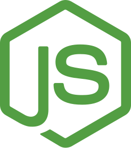

  <picture>
    <source media="(max-width: 520px)" srcset="assets/banner-mobile.svg">
    
  </picture>

## About Me

I’m a sixth-semester BS Software Engineering student at Superior University in Lahore, Pakistan, with an expected graduation year of **2028** and a **CGPA of 3.29/4.00**. I’ve interned in web development and data analysis. **Python and Node.js** are my strongest technical skills, and I’m interested in software development, data analytics, and software quality assurance.

I’m open to freelance and remote opportunities.

## Professional Focus

| Web Development | Software Development | Data Analysis |
| --- | --- | --- |
| Responsive websites | Python, Java, and C++ | Microsoft Power BI |
| Frontend and backend development | Object-oriented programming | Microsoft Excel |
| React and WordPress | Database applications | SQL and Google Sheets |
| Node.js and REST APIs | Application development and testing | Data cleaning and business research |

## Technology Stack

### Programming Languages

  &nbsp;Python &nbsp;
  &nbsp;JavaScript &nbsp;
  &nbsp;Java &nbsp;
  &nbsp;C++ &nbsp;
  &nbsp;SQL

### Web Development

  &nbsp;Node.js &nbsp;
  &nbsp;React &nbsp;
  &nbsp;HTML5 &nbsp;
  &nbsp;CSS3 &nbsp;
  &nbsp;Bootstrap &nbsp;
  &nbsp;WordPress

### Databases

  &nbsp;MySQL &nbsp;
  &nbsp;MySQL&nbsp;Workbench

### Data Analysis

  &nbsp;Microsoft&nbsp;Power&nbsp;BI &nbsp;
  &nbsp;Microsoft&nbsp;Excel &nbsp;
  &nbsp;Google&nbsp;Sheets &nbsp;
  &nbsp;Python &nbsp;
  &nbsp;SQL

### Software Testing

  &nbsp;Postman &nbsp;
  &nbsp;Manual&nbsp;Testing &nbsp;
  &nbsp;API&nbsp;Testing &nbsp;
  &nbsp;Functional&nbsp;Testing &nbsp;
  &nbsp;Bug&nbsp;Reporting

### Development Tools

  &nbsp;Git &nbsp;
  &nbsp;GitHub &nbsp;
  &nbsp;VS&nbsp;Code &nbsp;
  &nbsp;IntelliJ&nbsp;IDEA &nbsp;
  &nbsp;Android&nbsp;Studio &nbsp;
  &nbsp;NetBeans

## Professional Experience

### Web Development Intern · Badar Munir Ahmed Solutions

*June 2026 – August 2026*

Gained hands-on exposure to web technologies and development tools and learned how a professional software team organizes and carries out project work.

### Data Analyst Intern · VirtualUX (SMC-Private) Limited

*February 2026 – May 2026*

Conducted business research and B2B lead generation using LinkedIn Sales Navigator and Seamless.ai. Worked with Microsoft Excel, Microsoft Power BI, and Google Sheets. Cleaned and verified data and removed duplicate records.

## Featured Projects

### Development Projects

| Project | Development contribution |
| --- | --- |
| **Personal Portfolio Website** | Built a personal portfolio site with React, Vite, and Tailwind CSS. |
| **Online Shopping System** | Built a Java Swing application backed by MySQL. Implemented product browsing, a shopping cart, checkout, and order history. |

### Software Testing Projects

| Project | Testing contribution |
| --- | --- |
| **Attendance Management System** | Tested attendance workflows, validated database create, read, update, and delete operations, and checked report outputs. |
| **Courier Pick & Drop Website** | Tested booking and tracking flows and checked API behavior in Postman. |
| **File Explorer System** | Tested file operations and invalid inputs, and documented defects. |
| **Lost & Found Community App** | Tested the Flutter app’s form validation and authentication flows. |
| **AI/NLP Chatbot** | Tested intent recognition, response accuracy, fallback behavior, and the API. |

## Education & Training

**BS Software Engineering** · Superior University, Lahore

| Course or training | Date |
| --- | --- |
| AWS Cloud Practitioner Essentials (course completion) | October 2026 |
| SQL Fundamentals | December 2025 |
| Life Management Skills Training Program | March 2024 |
