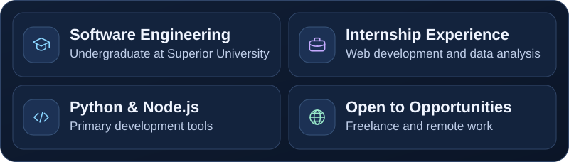
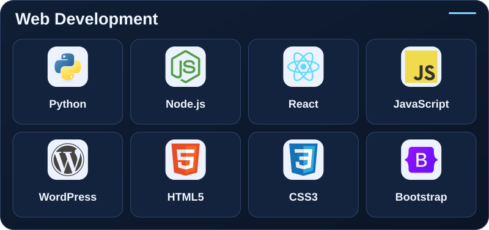
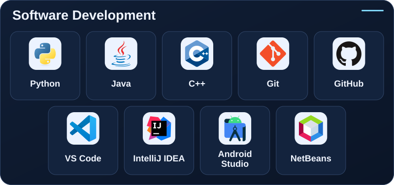
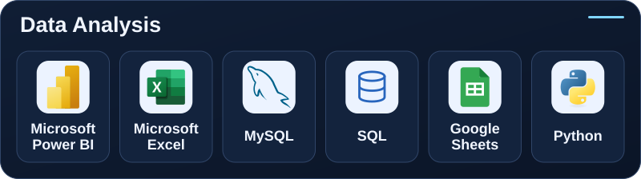
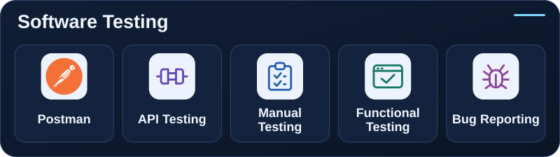
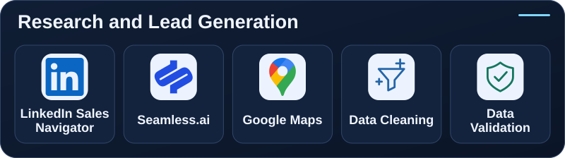
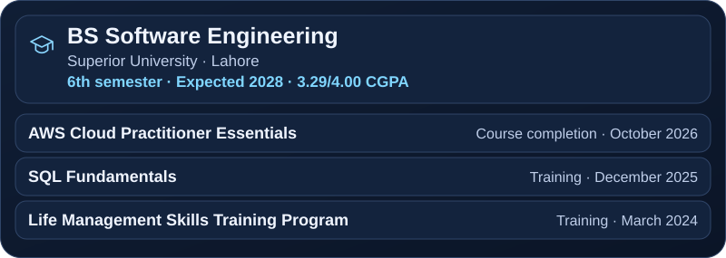

  <picture>
    <source media="(max-width: 600px)" srcset="assets/banner-mobile.svg">
    
  </picture>

## About Me

  <picture>
    <source media="(max-width: 600px)" srcset="assets/about-mobile.svg">
    
  </picture>

## Skills

  <picture>
    <source media="(max-width: 600px)" srcset="assets/web-development-mobile.svg">
    
  </picture>

  <picture>
    <source media="(max-width: 600px)" srcset="assets/software-development-mobile.svg">
    
  </picture>

  <picture>
    <source media="(max-width: 600px)" srcset="assets/data-analysis-mobile.svg">
    
  </picture>

  <picture>
    <source media="(max-width: 600px)" srcset="assets/software-testing-mobile.svg">
    
  </picture>

  <picture>
    <source media="(max-width: 600px)" srcset="assets/lead-generation-mobile.svg">
    
  </picture>

## Featured Projects

  <picture>
    <source media="(max-width: 600px)" srcset="assets/projects-mobile.svg">
    
  </picture>

## Professional Experience

  <picture>
    <source media="(max-width: 600px)" srcset="assets/experience-mobile.svg">
    
  </picture>

## Education & Training

  <picture>
    <source media="(max-width: 600px)" srcset="assets/education-mobile.svg">
    
  </picture>

